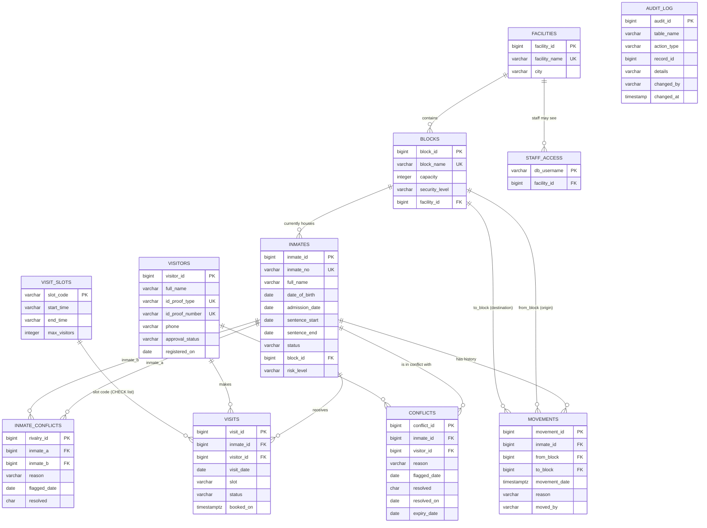

# ER Diagram, Relational Mapping and Normalisation (F1)

All data in this project is synthetic. Active DBMS: PostgreSQL (SQL + PL/pgSQL). The active schema is installed in `public`; the installation account owns the objects.

## 1. Entity-Relationship diagram

The diagram below uses Mermaid syntax. It renders in GitHub, VS Code (Markdown Preview Mermaid Support) and
[mermaid.live](https://mermaid.live). To get a picture for the report, paste the block into dbdiagram.io / draw.io or take a screenshot of the rendered preview.

`AUDIT_LOG` has deliberately **no relationship lines**: it records events about every table and about records that
were never created (denied visits), so it carries no foreign keys.

## 2. Entities, keys and cardinalities

| Entity | Primary key | Candidate / unique keys | Foreign keys | Spec origin |
|---|---|---|---|---|
| BLOCKS | block_id | block_name | facility_id → FACILITIES | core 1 of 7 |
| INMATES | inmate_id | inmate_no | block_id → BLOCKS | core 2 of 7 |
| VISITORS | visitor_id | (id_proof_type, id_proof_number) | – | core 3 of 7 |
| VISITS | visit_id | (inmate_id, visit_date, slot) | inmate_id → INMATES, visitor_id → VISITORS | core 4 of 7 |
| MOVEMENTS | movement_id | – | inmate_id → INMATES, from_block → BLOCKS, to_block → BLOCKS | core 5 of 7 |
| CONFLICTS | conflict_id | (inmate_id, visitor_id) | inmate_id → INMATES, visitor_id → VISITORS | core 6 of 7 |
| AUDIT_LOG | audit_id | – | none | core 7 of 7 |
| FACILITIES | facility_id | facility_name | – | F31 |
| INMATE_CONFLICTS | rivalry_id | (inmate_a, inmate_b) | inmate_a, inmate_b → INMATES | F14 optional |
| VISIT_SLOTS | slot_code | – | – (VISITS.slot is protected by a CHECK list) | F16 |
| STAFF_ACCESS | db_username | – | facility_id → FACILITIES | F31 |

| Relationship | Cardinality | How it is implemented |
|---|---|---|
| FACILITIES – BLOCKS | 1 : N | `blocks.facility_id` |
| BLOCKS – INMATES | 1 : N (an inmate lives in exactly one block at a time) | `inmates.block_id` |
| INMATES – VISITORS | **M : N** | resolved by the associative table **VISITS** (one row = one visit) |
| INMATES – VISITORS (forbidden pairs) | **M : N** | resolved by the associative table **CONFLICTS** |
| INMATES – INMATES (rivals) | M : N, recursive | associative table INMATE_CONFLICTS, `inmate_a < inmate_b` stores a pair once |
| INMATES – BLOCKS (history) | M : N | associative table **MOVEMENTS** which references BLOCKS **twice** (origin and destination) |

## 3. Relational mapping (ER → tables)

1. Every strong entity became a table whose identifier is the primary key (an IDENTITY column).
2. Every 1 : N relationship became a foreign key on the "many" side.
3. Every M : N relationship became an associative table holding the two foreign keys plus the attributes of the
   relationship itself (VISITS: date, slot, status; CONFLICTS: reason, flagged date; MOVEMENTS: date, reason).
4. The recursive relationship "rival" became INMATE_CONFLICTS with two foreign keys to INMATES.
5. Multi-valued/derived data was **not** stored: occupancy, visit counts and days remaining are computed (views and functions)
   so they can never contradict the base data.

## 4. Functional dependencies and BCNF proof

A table is in **BCNF** when, for every non-trivial functional dependency X → Y that holds in it, X is a superkey.

| Table | Functional dependencies | Determinants | Keys | BCNF? |
|---|---|---|---|---|
| FACILITIES | facility_id → facility_name, city; facility_name → facility_id | facility_id, facility_name | both are keys | Yes |
| BLOCKS | block_id → block_name, capacity, security_level, facility_id; block_name → block_id | block_id, block_name | both are keys | Yes |
| INMATES | inmate_id → inmate_no, full_name, date_of_birth, admission_date, sentence_start, sentence_end, status, block_id, risk_level; inmate_no → inmate_id | inmate_id, inmate_no | both are keys | Yes |
| VISITORS | visitor_id → full_name, id_proof_type, id_proof_number, phone, approval_status, registered_on; (id_proof_type, id_proof_number) → visitor_id | visitor_id, (type, number) | both are keys | Yes |
| VISITS | visit_id → inmate_id, visitor_id, visit_date, slot, status, booked_on; (inmate_id, visit_date, slot) → visit_id, visitor_id, status, booked_on | visit_id, (inmate_id, visit_date, slot) | both are keys | Yes |
| MOVEMENTS | movement_id → inmate_id, from_block, to_block, movement_date, reason, moved_by (an inmate may move many times, so nothing else determines a row) | movement_id | key | Yes |
| CONFLICTS | conflict_id → inmate_id, visitor_id, reason, flagged_date, resolved, resolved_on, expiry_date; (inmate_id, visitor_id) → conflict_id | conflict_id, (inmate_id, visitor_id) | both are keys | Yes |
| INMATE_CONFLICTS | rivalry_id → inmate_a, inmate_b, reason, flagged_date, resolved; (inmate_a, inmate_b) → rivalry_id | rivalry_id, (a, b) | both are keys | Yes |
| AUDIT_LOG | audit_id → table_name, action_type, record_id, details, changed_by, changed_at | audit_id | key | Yes |
| VISIT_SLOTS | slot_code → start_time, end_time, max_visitors; start_time → slot_code | slot_code, start_time | both are keys | Yes |
| STAFF_ACCESS | db_username → facility_id | db_username | key | Yes |

Because every determinant is a key in every table, **the whole schema is in BCNF** (and therefore also in 1NF, 2NF and 3NF).

### Decomposition from one big spreadsheet

Imagine the first draft, a single sheet with one row per visit:

`inmate_no, inmate_name, sentence_end, block_name, block_capacity, block_security, visitor_name, id_proof_type, id_proof_number, approval_status, visit_date, slot`

| Step | Problem found | Fix |
|---|---|---|
| **1NF** | Several visitors per inmate crammed in one cell; repeating column groups | One atomic value per cell, one row per visit |
| **2NF** | The key is (inmate, visitor, date, slot). `inmate_name` depends only on the inmate part; `visitor_name`, `id_proof_*`, `approval_status` only on the visitor part (partial dependencies) | Split into INMATES, VISITORS and VISITS |
| **3NF** | `block_capacity` and `block_security` depend on `block_name`, not on the inmate (transitive dependency inmate → block → capacity) | Split out BLOCKS; INMATES keeps only `block_id` |
| **BCNF** | Every remaining determinant must be a key: natural keys (`inmate_no`, `block_name`, ID proof) are declared `UNIQUE`, surrogate IDs are primary keys | Result: the tables in section 2 |
| Extras | Movement history, conflicts and audit entries are facts about *events*, not attributes of an inmate | MOVEMENTS, CONFLICTS, AUDIT_LOG |

### Deliberate design choices (viva talking points)

* **Surrogate keys** (`*_id` identity columns) keep foreign keys small and stable even if a name changes; the natural keys stay protected by UNIQUE constraints.
* **Soft delete**: inmates and visitors are never deleted; `status` / `approval_status` changes instead. Foreign keys use the default
  `NO ACTION` so history cannot be orphaned.
  * **`risk_level`, `facility_id`, `resolved`, `expiry_date`** are defined in the active PostgreSQL schema. The original Oracle `ALTER TABLE` demonstration remains under `sql/02_alter_schema.sql`.
* **Occupancy is not stored**: it is `COUNT(*)` of ACTIVE inmates in a block, so it cannot drift out of sync with INMATES.
